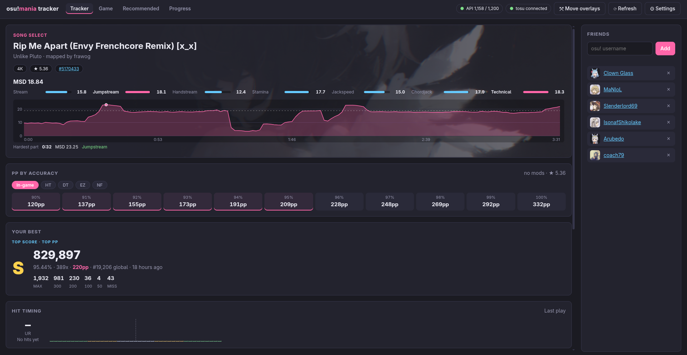
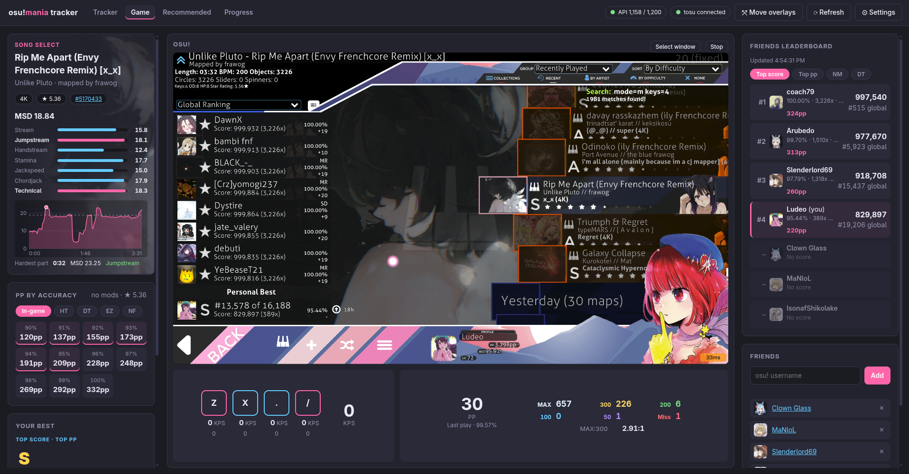
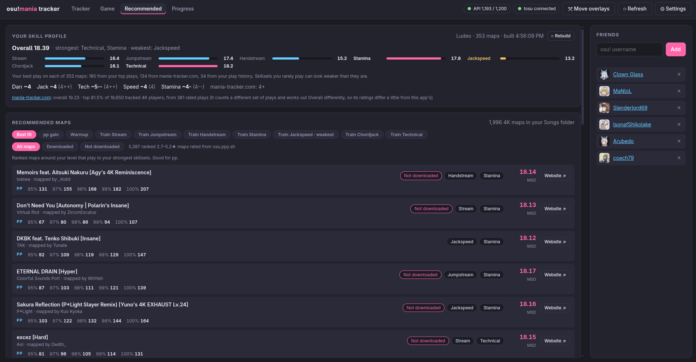
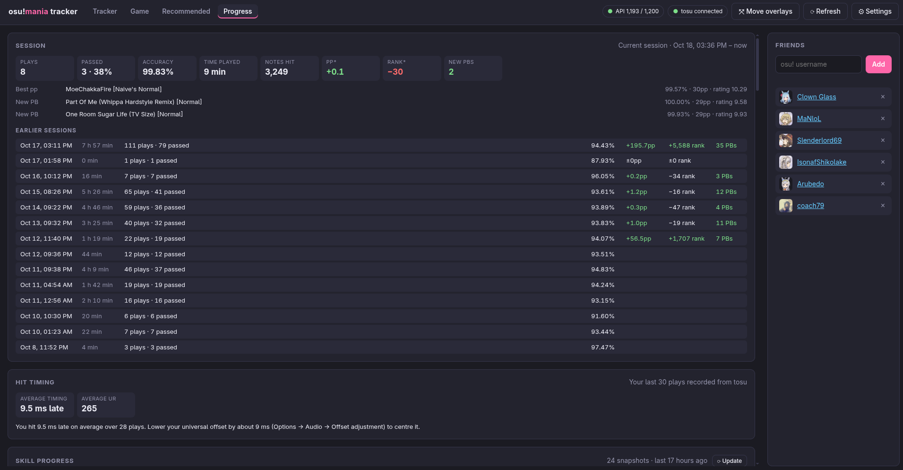
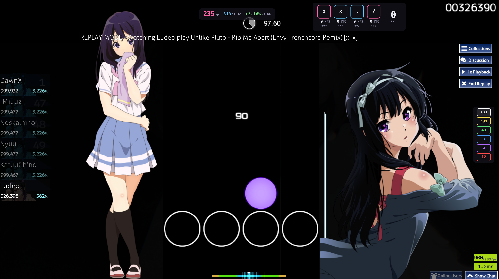

> [!IMPORTANT]
> This app is 100% made by AI (Opus 5.5 Medium Effort)

# osu!mania Tracker

An Electron app that detects the map you're on in osu! and shows your best osu!mania score next to your friends' scores.

## Preview







## How it works

```
osu! ──memory──▶ tosu ──WebSocket──▶ renderer (map detection, UI)
                                         │ IPC
                                         ▼
                                main process ──HTTPS──▶ osu! API v2 (scores, users)
                                         │
                                         └──HTTPS──▶ mania-tracker.com (tracked plays, ratings; optional)
```

- **Map detection** uses [tosu](https://github.com/tosuapp/tosu), a memory reader that works with osu! stable (Windows and Linux/Wine) and lazer. It publishes the current game state on `ws://127.0.0.1:24050/websocket/v2`. The older gosumemory `/ws` endpoint also works.
- **Scores** come from the official osu! API v2 (`/beatmaps/{id}/scores/users/{user}/all?mode=mania`). The leaderboard has tabs for the top score, the highest pp, and one per mod combination (NM, HT, DT, …). Visual mods such as HD or MR are ignored when grouping. Converted maps work too.
- Scores load when you select a map (debounced while you scroll through song select). They reload ~4s after the results screen appears, so a new PB shows up automatically.
- **PP by accuracy** uses osu!'s mania pp formula with the star rating from tosu. pp depends on how your hits are spread over the judgements (MAX counts more than 300), so each accuracy is filled with a realistic spread modelled from the map's OD rather than tosu's "all MAX plus 50s", which overestimates by about 20%. Treat the values as estimates.
- **Skillsets** are rated with [Etterna](https://github.com/etternagame/etterna)'s MinaCalc, the calculator behind Etterna's MSD. The now-playing card shows the overall MSD and the values for Stream, Jumpstream, Handstream, Stamina, Jackspeed, Chordjack and Technical, with the two highest skillsets highlighted. Below them, a **difficulty graph** shows the MSD of the 10 seconds around each point of the map, so difficulty spikes and breaks stand out. The dashed line is the whole map's MSD and the dot marks the hardest part. Hover over the graph for the time, MSD and main skillset of that part. DT and HT rate the map at 1.5x and 0.75x. The `.osu` file comes from tosu, or from osu.ppy.sh if tosu's file doesn't match the selected map. Only native 4K maps are rated, since MinaCalc is tuned for 4K. MinaCalc rates long notes like taps, so maps with more than 30% LNs get a warning that they're probably underrated.
- **Game** (tab at the top) shows a live view of the osu! window in the middle, with the tracker's cards around it: now playing, pp by accuracy and your best on the left, the friends leaderboard and the Friends panel on the right. **Select the osu! window** opens the desktop's window picker on Wayland (through xdg-desktop-portal and PipeWire); on X11 the app lists the windows itself, with osu! first. It's a view only: play in the osu! window itself, since input on the view doesn't reach the game. The view stops when the osu! window closes.
  - The view takes the osu! window's aspect ratio at full width, so a 16:9 window has no black bars above and below. The space left below holds the HUD.
  - **Key overlay:** your four 4K keys light up while held, with keys per second (presses in the last second) for each finger and in total, and each key's presses in the current play. The keys are the 4K layout selected in osu!, read from `osu!.<user>.cfg` next to the Songs folder (D F J K if it isn't found). tosu doesn't report mania keys, so the app reads the keyboard itself: on Linux from `/dev/input`, which needs your user in the `input` group, and on Windows with a keyboard hook ([uiohook-napi](https://github.com/SnosMe/uiohook-napi)). The hook can't see keys sent to a program running as administrator, so don't run osu! as administrator. Only those four keys are picked up, and only while the Game view (or the in-game overlay) is open. Keys are matched by their position on a US layout.
  - **Play:** pp of the play in progress (with the pp for an FC) or on the results screen, its accuracy and judgements (MAX, 300, 200, 100, 50, Miss), and the MAX:300 ratio. The last play stays until the next one starts.
  - **vs PB:** the play's accuracy against your PB's on the map, green while you're ahead and red while you're behind. The PB is your best score with the same mods that change accuracy (DT, HT, EZ, HR), or your best score overall if you have none with them. It's the PB from when the play started, so a new PB that loads after the results screen doesn't replace it.
  - On narrow windows the key overlay and the play panel go on two rows.
- **Hit timing** (a card on the Tracker view, in the left column of the Game view): the latest play's unstable rate, whether you hit early or late on average, and a histogram of your hit errors from the 200 window early to the 200 window late, coloured by the judgement they get, with a line at 0 ms and a marker at your mean. The hit errors are the ones osu! records, read by tosu, so they include long note releases.
- **In-game overlay** (off by default, see Settings): two small see-through windows above osu!, so you can see them while you play: the pp of the play in progress with the pp for an FC and your accuracy against your PB (as in the Game view), and the key overlay from the Game view (keys lighting up, keys per second per finger and in total, presses this play). They show while you're playing and on the results screen, and clicks go through them to the game. Click **Move overlays** at the top of the app to unlock them, drag each into place and drag its bottom-right corner to resize it, then click **Lock overlays** (or **Lock** on an overlay). They come back where you left them, at the same size; the first time the pp is at the top centre of the main screen and the keys at its left edge. The overlays read tosu and the keyboard themselves, so they keep up while the app is minimised or behind the game.
  - On Linux it runs as a second process under X11 (XWayland on a Wayland desktop), because Wayland doesn't let a window keep itself above others or choose where it goes. Since it never takes focus, it's an override-redirect window, which KDE stacks above every window, fullscreen osu! included. Other window managers may keep fullscreen windows on top; use osu!'s borderless or windowed mode there.
  - On Windows the overlays are ordinary always-on-top windows. osu!'s exclusive fullscreen mode probably covers them, so play borderless or windowed.
- **Recommended** (tab at the top) builds a skill profile and suggests maps from your Songs folder:
  - **Library:** every 4K map in the Songs folder is rated once and cached in `library-cache.json` next to the config. Later scans only rate new or changed files. The folder comes from tosu, or from the setting if you've set one.
  - **Profile:** your plays are rated with MinaCalc at your accuracy, the way Etterna rates scores (SSR), and combined per skillset with Etterna's player rating formula. Like Etterna, only your best play on each map counts. The plays come from three places:
    - your top 200 plays (the most the osu! API returns);
    - your plays on [mania-tracker.com](https://mania-tracker.com), if it tracks you: it keeps plays that never made your top 200 or have dropped out of it (on by default, see Settings);
    - the passed 4K plays in your play history (see **Progress**), which includes loved and unranked maps.

    MinaCalc expects Etterna's Wife accuracy, so each play's Wife % is estimated from its judgements and the map's OD. Map files missing from the Songs folder are downloaded and kept in `maps/`. Rated plays are cached while the app runs, so rebuilding only rates new plays. Hovering over the play count shows how many maps come from each source.
  - **Strengths:** your two highest skillset ratings are your strongest and the lowest is your weakest. The bars run from the weakest (shortest) to the strongest (full).
  - **Maps you don't have:** ranked 4K maps from osu.ppy.sh are rated too. The app searches for them in a star range around your top plays, most played first, and rates each one from its `.osu` file. osu.ppy.sh serves about two files per second, so this runs in the background whenever the Recommended tab has been opened, and the list refreshes as maps come in. Up to 2,500 sets are covered, and the search is repeated weekly for newly ranked maps. Only the ratings are kept, in `online-cache.json`.
  - **Best fit** lists ranked maps around your overall rating whose most pronounced skillsets are your strongest. **pp gain** lists ranked maps within 2 MSD below to 1 MSD above your overall rating where a good play would raise your total pp, sorted by how much it would add (weighted like on your profile, without bonus pp). That's either a new play entering your top 100, or a better score on a map you already have in your top plays, which replaces the old one; those cards show your current best. The expected accuracy of a good play is a straight line fitted to your profile plays' accuracy against how far each map's MSD is above your rating, kept between your 10th and 90th percentile accuracy. The card shows that accuracy, its pp and the gain. Maps whose star rating is high for their MSD come out on top, so expect jack and chordjack maps. **Warmup** lists maps of any skillset at about 72–90% of your overall rating, to warm up on before harder maps. **Train …** lists maps that focus on one skillset, slightly above your rating in it. Maps your profile was built from (except in pp gain), duplicates and LN-heavy maps are left out. **All maps / Downloaded / Not downloaded** chooses where the maps come from.
  - Ranked maps show the estimated nomod pp at 95, 97, 98, 99 and 100%, calculated the same way as on the now-playing card from the map's star rating, OD and note count on osu.ppy.sh.
  - Maps you don't have are marked **Not downloaded**. Local maps that give no pp are marked Loved, Unranked or Unsubmitted, and **Update needed** means your copy differs from the version on osu.ppy.sh.
  - Clicking a map depends on whether you have osu!supporter, because osu! stable only handles `osu://b/<id>` links in game for supporters (others get the website, and there's no other way to select a map from outside the game):
    - **With supporter**, the map opens in osu! through that link (osu!direct for maps you don't have). osu! registers the link when it's installed; on Linux, osu-winello sets this up.
    - **Without supporter**, clicking a downloaded map copies a song select search for it (title and difficulty) to paste with Ctrl+V. Clicking a map you don't have downloads its set without video from a mirror (osu.direct, or catboy.best if that fails) and opens the `.osz`, which osu! imports; on Linux, osu-winello registers `.osz` files with osu!. osu! then selects a difficulty of the set itself, which can't be changed from outside the game without supporter. So once osu! has imported the set into the Songs folder, the app rescans the folder (the map shows as downloaded, without a rebuild) and copies the song select search for the recommended difficulty, unless tosu shows it's already selected. Unsubmitted maps always copy the search, since they have no ID.
    - **Website** always opens the beatmap page.
    - With **Switch to the Game view after picking a map** in Settings (on by default), the app switches to the Game view once the search is copied or the downloaded set has been imported.
  - **Dan:** your 4K dan, overall and per skill (jack, tech, speed, stamina), estimated from the plays in your profile the way [mania-tracker.com describes it](https://mania-tracker.com/dan-estimates). Every 4K regular chart gets a dan from its MinaCalc rating at the rate you played. Each pass is credited that dan, adjusted by its accuracy against a 96% bar (a bonus that stays small until 99%, halved on jack charts; less below 96%, nothing below 91%). It counts towards the skill its MSD skillsets lean to most. A skill's dan is the average of its 20 best passes and needs at least 4. Your dan is the average of your skills. A pass of a Dan ~ REFORM ~ course sets a floor for the overall dan, and a pass of one of yzuio's skillset practice charts sets one for its skill. LN charts (45% holds or more) aren't rated. Hover over the dan for how it was worked out, and over a skill for the passes behind it. If mania-tracker.com is on, its own dan is shown next to the estimate (per skill in brackets).

    mania-tracker.com rates charts with its own estimator, which isn't public, so the app maps MinaCalc MSD to dan with a table fitted to the dans the site gives about 1,800 charts. On a single chart that's typically about half a dan off, but it mostly averages out. Tested against eight players from dan 4 to 16, the overall dan was 0.4 off on average, and a single skill 0.7. The skill a chart counts towards matches the site's for about 80% of charts. Turn it off with **Estimate dan levels** in Settings. It needs no extra requests.
- **mania-tracker.com** also shows up on the profile card: its overall rating and where that puts you among the 4K players it tracks ("top X%", as on the site). Its map ratings match the app's, but it counts a different set of plays and works out Overall differently, so its ratings differ a little from the app's.
- **Progress** (tab at the top) tracks how you play over time:
  - **Play history:** every play is recorded from tosu while the app is open, passed or not: when the results screen comes up it counts as passed, and when you leave or restart a play before that it counts as **failed or quit** (attempts shorter than 20 notes aren't recorded). Replays, spectating and autoplay are left out, since tosu reports someone else's name for them. A few seconds after a pass on a submitted map, the app looks up the submitted score for its pp and whether it's a new **personal best**. Plays made while the app was closed are imported when the tab opens: the last 24 hours from the osu! API (failed plays included) and your latest plays on mania-tracker.com. The same play from several places is only kept once. Each passed 4K play gets its MinaCalc score rating. Filter by passed plays, personal bests, or failed and quit plays.
  - **Session:** plays with less than an hour between them make a session. The current (or last) one shows plays, pass rate, average accuracy, time played, notes hit, new PBs, the best play by pp and by rating, and how your pp and global rank changed. pp and rank are checked when a play starts and after each pass while the app is open; if the app was started during a session, the change counts from then (marked \*). Earlier sessions are listed below.
  - **Hit timing:** your average timing and unstable rate over your last 30 plays recorded from tosu (plays with at least 50 hits). Once at least 5 of them are without rate mods on maps with at most 30% long notes, it suggests how much to raise or lower your universal offset (Options → Audio → Offset adjustment) to centre your hits, if they're 3 ms or more off. Only those plays count towards the average timing: long note releases skew it, and rate mods change how hit errors relate to the offset. Each play in the history shows its UR and timing too.
  - **Skill progress:** the dan estimate and a chart of your skillset ratings over time. **This app** shows a snapshot of your skill profile each time it changes: when it's built (here with **⟳ Update**, or on the Recommended tab) and after each passed 4K play once it has been built. **mania-tracker.com** shows the site's rating history for you, which goes back to when it started tracking you. Click a skillset to hide or show it; hover over the chart for the ratings at that time.
  - Everything is stored in `history.json` next to the config.
- Unsubmitted or local maps have no online leaderboard. The app tries a checksum lookup before giving up.

## Setup

1. **Install and run tosu.** Download it from the [releases](https://github.com/tosuapp/tosu/releases) and start it alongside osu!.
2. **Create an osu! OAuth application.** Go to [osu.ppy.sh → Settings → OAuth](https://osu.ppy.sh/home/account/edit#oauth) and click "New OAuth Application". The callback URL can be anything (e.g. `http://localhost`).
3. **Install and start the app:**
   ```bash
   npm install
   npm start
   ```
4. On first launch the settings panel opens. Paste your **client ID** and **client secret**, and optionally your **username** (if you leave it empty, the player logged into osu! is used).
5. Add your friends' usernames in the **Friends** panel. Each name is checked against the osu! API and stored by user ID, so renames don't break your list.
6. **Use mania-tracker.com** in Settings is on by default. It sends only your osu! user ID to mania-tracker.com, to get the plays it has tracked for you, your ratings and their history. Turn it off to use the osu! API and your own play history only. If the site doesn't track you yet, looking yourself up there starts tracking. **Estimate dan levels** is on by default too; it works offline from your profile's plays. Turn on **In-game overlay** to see the live pp and your keys with keys per second over osu!.
7. For recommendations, the Songs folder is taken from tosu. If tosu reports a path that doesn't exist on Linux, set the **osu! Songs folder** in Settings, e.g. `~/.local/share/osu-wine/osu!/Songs`.

Settings are stored in `~/.config/osu-mania-tracker/config.json` on Linux (`%APPDATA%\osu-mania-tracker` on Windows). The file is created with `0600` permissions because it contains your client secret. `npm start` and the packaged builds share this file.

## Builds

### Linux

```bash
npm run dist:linux
```

This writes `dist/osu-mania-tracker-<version>-x86_64.AppImage`, a single file. Run it with `chmod +x` and then `./osu-mania-tracker-*.AppImage`. AppImages need FUSE 2 (`fuse2` on Arch, `libfuse2` on Debian/Ubuntu). Without it, add `--appimage-extract-and-run`.

### Windows

```bash
npm run dist:win
```

This works on Linux too, without Wine. It writes `dist/osu-mania-tracker-<version>-win-x64.zip`, the unpacked app. Extract it and run `osu-mania-tracker.exe` inside.

The builds aren't code-signed, so Windows SmartScreen warns the first time you run them (**More info**, then **Run anyway**).

The icon comes from `build/icon.png`, which is rendered from `build/icon.svg` (`rsvg-convert -w 512 -h 512 build/icon.svg -o build/icon.png`).

## MinaCalc

MinaCalc is vendored in `native/etterna` from Etterna commit `2d706147` (calc version 527, MIT, see `native/etterna/LICENSE`). Only the `MinaCalc` folder and `Models/NoteData/NoteDataStructures.h` are copied. One change was made: `MinaCalc.cpp` skips loading calc parameters from disk when built with `STANDALONE_CALC`, because that code needs the rest of Etterna.

It's compiled to WebAssembly in `src/main/minacalc-wasm.js`, which is checked in, so `npm start` and the builds don't need a C++ toolchain. To rebuild it after updating the vendored files, install [Emscripten](https://emscripten.org/docs/getting_started/downloads.html) and run:

```bash
source /path/to/emsdk/emsdk_env.sh
npm run build:minacalc
```

## Project layout

| Path | Purpose |
|---|---|
| `src/main/index.js` | Entry point: starts the app, or the overlay in its own process |
| `src/main/main.js` | Window, IPC handlers, combining and sorting the leaderboard |
| `src/main/osuApi.js` | osu! API v2 client (client-credentials token, users, scores) |
| `src/main/maniaPp.js` | Mania pp formula and the hit-spread model for pp by accuracy |
| `src/main/skillsets.js` | Loads the selected map's `.osu` file and rates its skillsets, overall and through the map |
| `src/main/osuFile.js` | `.osu` parser and conversion to MinaCalc note rows |
| `src/main/library.js` | Scans and caches the 4K maps in the Songs folder |
| `src/main/catalogue.js` | Finds and rates ranked 4K maps from osu.ppy.sh in the background |
| `src/main/keyInput.js` | Reads the 4K keys bound in osu! from the keyboard (evdev on Linux, a keyboard hook on Windows) for the key overlay and the in-game overlay |
| `src/main/overlay.js` | Starts and stops the in-game overlays' process and talks to it over stdin/stdout |
| `src/main/overlayProcess.js` | The in-game overlays' process: their windows (above osu!, click-through while locked), key input, moving and resizing |
| `src/main/profile.js` | Skill profile from your plays: Wife estimate, score ratings, best play per map, Etterna's rating aggregation |
| `src/main/history.js` | Play history, pp and rank snapshots, skill rating snapshots and sessions (`history.json`) |
| `src/main/maniaTracker.js` | mania-tracker.com client: tracked plays, ratings, dan, rating history and recent plays |
| `src/main/dan.js` | Dan estimate: MSD to dan table, accuracy credit, skill per chart, REFORM course and practice chart floors |
| `src/main/recommend.js` | Strengths and weaknesses, and picking maps for a focus |
| `src/main/minacalc.js` | JavaScript wrapper around the MinaCalc WebAssembly build (`minacalc-wasm.js`) |
| `native/` | Vendored MinaCalc source, its C interface and the WebAssembly build script |
| `src/main/config.js` | JSON config persistence |
| `src/main/preload.js` | `window.tracker` bridge (context isolation on, sandboxed) |
| `src/main/overlayPreload.js` | `window.overlay` bridge for the overlay's page |
| `src/renderer/tosu.js` | tosu/gosumemory WebSocket client with auto-reconnect and payload normalisation |
| `src/renderer/playInfo.js` | Shared by the app and the overlays: hit timing (UR, mean, hit windows) and picking the PB to compare a play with |
| `src/renderer/renderer.js` | UI rendering and app logic |
| `src/renderer/overlay.*` | The in-game overlays' page: pp with the pp for an FC, or the keys with keys per second |
| `build/` | App icon, used for the window and bundled into packaged builds |

## Notes

- npm 12 doesn't run dependency install scripts, so a root `postinstall` downloads the Electron binary.
- Lazer-only scores use `total_score`. Stable scores show the classic score (`legacy_total_score`) that you see in game.
